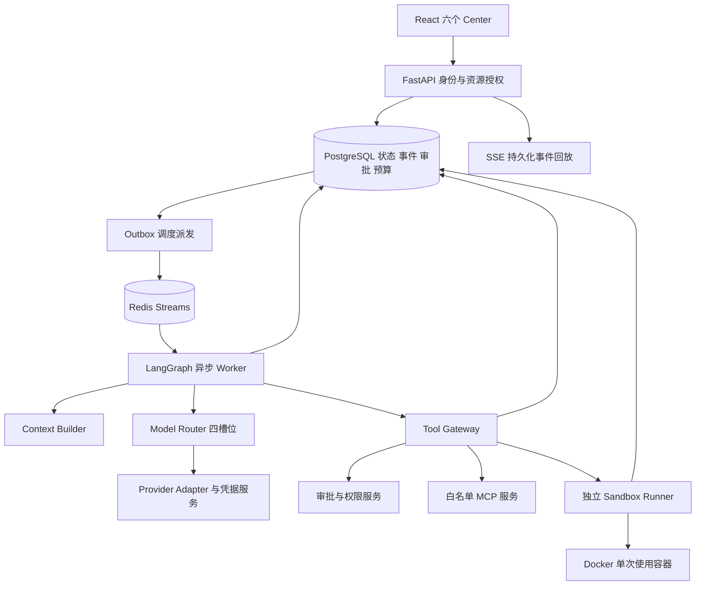
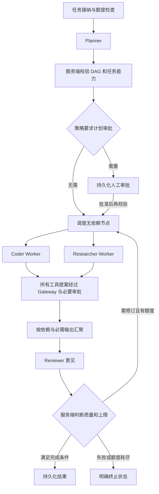

# AgentForge AI P0 架构设计与技术选型

本基线将四模型协作、工具权限、代码执行与人工审批纳入同一套可持久化任务流程。以下组件、接口和默认值均为待实施设计；本轮只交付文档。项目根目录为 `D:\AIProjects\AgentForge-AI`。

## 1 技术选型与服务边界

| 组件 | 选型 | 职责与约束 |
| --- | --- | --- |
| API | FastAPI、Pydantic、SQLAlchemy、Alembic | 身份、资源权限、配置、任务、审批、查询与 SSE；请求进程不运行不可信代码 |
| 编排 | LangGraph | 持久化图、分支汇聚、人工中断与有限反馈循环 |
| 模型与检索 | LangChain 加自有 Provider Adapter | 适配聊天、结构化输出、检索；适配器不能直接获得工具执行权限 |
| 前端 | React、TypeScript、Vite | 六个管理页面；服务端决定权限和真实状态 |
| 业务持久化 | PostgreSQL | 配置、任务、事件、审批、计量、副作用账本与 LangGraph 持久化检查点 |
| 检索 | PostgreSQL 加 pgvector | 租户范围向量检索；embedding 单独声明供应商、费用和凭据，不新增第五个 Agent 模型槽位 |
| 调度与缓存 | Redis Streams | 消费组、唤醒、通知、短期缓存；不能作为唯一任务状态、审批或预算存储 |
| 执行隔离 | 独立 Sandbox Runner 加 Docker Engine | 只接收受限执行协议；与 API、编排进程分离，不能开放任意 Docker API |
| 实时输出 | SSE | 单向事件输出；取消、审批和配置写操作使用鉴权 HTTP 接口 |
| 监控 | OpenTelemetry、Prometheus 指标接口 | 关联追踪和聚合指标；原始提示词、工具参数和密钥不进入默认遥测 |

P1 锁定受维护且兼容的 Python、Node、Docker、LangGraph 和数据库版本，并记录锁文件和镜像 digest；本轮不猜测已安装版本。Windows 开发以 Docker Desktop 的 Linux 容器环境为候选，验收需实际验证 seccomp、cgroups 和限制生效。部署建议使用独立 Linux 执行节点。不可因平台差异放宽安全策略。

只有可信 Runner 获得 Docker daemon 控制权限；API、Agent、MCP 服务、Skills 与任务容器均不得挂载或访问 Docker Socket。Runner 对 daemon 的访问位于可信控制面，使用专用本地受控通道或受保护的远程连接；该权限接近宿主机管理权限，必须隔离 Runner。模型 HTTP 与 Researcher 检索在受控服务端完成，不能靠开放沙箱外网来访问 API。

## 2 四模型配置和路由

每个租户或项目拥有四个固定角色槽位。角色枚举是 `planner`、`coder`、`researcher`、`reviewer`；模型名称、供应商和凭据不要求互异，同一供应商可绑定多个模型，也可绑定四个不同供应商。

| 字段 | 契约 |
| --- | --- |
| provider | 服务端允许的适配器标识，不接受任意可执行插件名 |
| base_url | 管理员批准的端点；生产 HTTPS，禁止 URL 内嵌凭据和带密钥查询参数 |
| model | 对应供应商的模型标识，并登记能力与上下文窗口 |
| credential_reference | 不可枚举的凭据引用，必须属于当前租户并允许该供应商使用 |
| temperature | 按供应商能力校验范围；不支持时明确拒绝或显示不支持 |
| max_tokens | 输出 Token 上限，正整数；受模型能力、任务剩余额度双重限制 |
| timeout | 单次调用秒数，正整数；实际值不超过任务剩余 deadline |
| enabled | 独立启停；任务所需槽位停用时拒绝或暂停，不隐式改路由 |

服务端附加配置版本、能力声明、计价版本、创建更新时间。任务开始固定四槽位的非秘密配置快照和版本；在途任务不偷偷切换模型。凭据轮换可更新秘密值，撤销授权立即阻止后续调用。

Planner 只用于规划与依赖分析；Coder 用于代码、工具调用提案和运行结果分析；Researcher 用于检索、文档理解及 RAG；Reviewer 只输出审查意见和反馈。Router 根据服务端节点角色选槽位，禁止 Agent 在输出中指定新凭据、私有端点或替换路由。Reviewer 的通过意见不代表权限许可或真实测试通过。

Provider Adapter 统一请求、流式事件、结构化响应、usage、错误类别与请求 ID。适配器登记结构化输出、工具提案、流式 usage、缓存 Token 等能力；不兼容能力启动前报错。P1 至少实现一种真实协议适配与明确 Mock，后续按批准的供应商扩展适配器；四种供应商组合必须使用协议契约测试验证，不能将所有 provider 当作天然兼容。

超时、429、暂时 5xx 可按剩余额度重试，初始最多额外重试 2 次，采用退避和抖动；401、403、配置错误不自动重试。响应结构错误最多一次修复尝试且计入调用上限。必需分支失败不能被 Reviewer 掩盖；可选分支可显示明确降级及缺失证据。P0 默认不启用跨模型自动故障切换，失败不会切 Mock。

Mock 必须显式选择，凭据可为空，返回 `is_mock=true`、`execution_mode=mock`；配置页、任务结果、SSE、统计均显示 Mock。真实和 Mock 调用混合时逐调用标识，任务标为 mixed，不能把混合结果呈现为全真实。Mock 成本单独统计为模拟值。

## 3 凭据与端点保护

凭据写入接口为单向输入，TLS 传输，成功仅返回引用和 configured 状态。浏览器不保留 Key 于 localStorage、URL 或持久缓存；列表、详情、导出、错误及 SSE 永不返回原 Key，也不返回部分 Key 作为提示。密钥由服务器秘密存储托管，开发可采用数据库信封加密，主密钥来自部署秘密注入且不进入仓库；生产使用外部 Secret Manager/KMS 适配。解密只发生在获授权适配器的调用边界。

禁止将秘密写进图状态、检查点、Prompt、沙箱环境、工具参数审计、追踪、请求体日志和异常堆栈。配置序列化采用字段白名单，日志在入口、HTTP 客户端和异常出口统一脱敏，并测试 Key 的异常回显。不得依赖前端隐藏字段保障安全。Git 忽略本地秘密文件，示例只含占位符，提交检查与 CI 扫描防止秘密进入 Git；若误入 Git 须撤销并轮换，不以删除当前文件替代。

base_url 和 MCP/检索端点采用服务端白名单、DNS/IP 和重定向校验，禁止访问 metadata、loopback、链路本地和未授权私网。确需本地模型时由部署管理员登记专用端点和最小出口策略，Agent 无权添加。拒绝跨域转发 Authorization，出口规则阻止 DNS 重绑定绕过。数据发送给模型前按租户的数据策略裁剪和脱敏。

## 4 LangGraph 协作与持久化

Planner 输出带稳定 node_id 的 DAG：角色、depends_on、输入输出引用、必需或可选、资源读写范围、能力要求与完成标准。服务端验证无环、节点数、角色、权限、预算和引用合法性。Coder 与 Researcher 仅在无数据依赖且无共享资源写冲突时并发，单个任务初始并发 Worker 上限 2；同租户及系统还有独立上限。并发结果按 node_id 幂等合并，不以最后写覆盖或依赖不确定完成顺序。

任务与节点状态集合为 queued、running、waiting_approval、retry_wait、cancel_requested、succeeded、failed、cancelled、timed_out、limit_exceeded、needs_reconciliation；新任务从 queued 开始。终态通过 PostgreSQL 版本号 CAS 写入，不能被迟到模型响应或 SSE 消费者改回成功。分支失败按依赖阻止下游；必需失败终止任务，可选失败标记缺失。Reviewer 故障后允许返回已保存草稿，但不标为已完成审查。

LangGraph 使用 PostgreSQL checkpointer，不使用仅内存检查点作为持久化方案。检查点是图恢复位置；任务业务状态、预算和副作用账本另行持久化。官方说明内存检查点不能跨进程重启恢复，见 [LangGraph persistence](https://docs.langchain.com/oss/python/langgraph/persistence)。恢复只使用服务器生成的 task_id/thread_id，并进行租户授权。

任务状态与调度 outbox 同事务提交，派发到 Redis Streams 允许重复但不能丢失；消费组 ACK 在结果提交后发生。Worker 通过 PostgreSQL 租约和递增 fencing token 领取节点，过期 Worker 无权提交或发起新的副作用；Gateway 和 Runner 也检查 token。Redis 重启可从数据库重建调度，缓存丢失不丢审批和预算；数据库或授权服务不可用时不开展新副作用。

副作用标识绑定 tenant_id、task_id、node_id、逻辑操作序号和参数哈希，同一操作重试复用稳定标识；生成不同修订操作时新建标识。重复创建任务以租户范围 Idempotency-Key 处理，相同 key 不同载荷返回冲突。执行前登记操作，已完成操作返回保存结果。外部服务支持 idempotency key 时传递；请求发送后状态不明且外部服务不支持幂等时进入 needs_reconciliation，不盲目重放。模型请求可能重复计费，不能声称外部请求 exactly once。

恢复中，已完成节点不再次执行；可安全重试的读取从最近检查点继续；已启动沙箱通过 execution_id 和容器标签对账，不能凭超时猜测未执行。检查点、业务账本和事件采用关联版本协调，跨表/外部系统不能原子提交的边界使用 outbox 和对账处理。

## 5 超时取消与限额

| 项目 | 初始默认策略 | 执行方式 |
| --- | --- | --- |
| 总任务期限 | 15 分钟 | 包含排队、重试和审批等待，持久化绝对 deadline |
| 模型超时 | 60 秒 | 槽位可独立设置，取剩余 deadline 与配置较小值 |
| 工具超时 | 30 秒 | 工具注册可进一步收紧，不能被提案放大 |
| 沙箱超时 | 30 秒，上限 120 秒 | Runner watchdog 与镜像内只读可信 launcher 双重执行期限 |
| 迭代 | 8 轮 | 首轮 Worker 与审查算一轮，每次反馈修订增加；恢复不重置 |
| 调用次数 | 32 次模型尝试、50 次工具尝试 | Planner、Reviewer、修复与重试都计入 |
| Token | 每任务 100000 | 输入、输出、隐藏推理和缓存按供应商计量分类，计数定义须避免重复 |
| 金钱预算 | 每任务 1 USD 规划账面上限 | 必须登记价格/币种；用户可收紧，管理员才可调策略上限 |

这些是初始参数，不代表性能承诺或供应商价格。任务创建时用户只可在服务端上限内调整，Agent 不得增加额度。图 recursion_limit 另作内部防死循环保护，不替代业务迭代计数。

每次模型调用前，用 PostgreSQL 原子事务预留输入 Token 加最大输出 Token 和对应成本，并校验任务、租户日额度；并发分支不能各自读取余额后超卖。无法估算输入或模型实际计费项时使用已登记的保守上界；没有有效价格或无法确定上界则阻止付费调用。返回后按 usage 和价格版本结算，异常、超时和断流保留可能已发生的费用预留直到对账，不立即释放为零。重试需要新的预留。

成本按输入、输出、缓存、推理等不重叠计费类别的 Token 数乘单价汇总，存 Decimal、原币种、价格版本与生效时间。缓存若属于 input 的子集，先从普通 input 扣除，推理若属于 output 子集同理，避免双算。汇率用于展示时保存版本；预算使用同一结算币种。usage 缺失标记 estimated/pending/unknown；估算不能伪装为账单实付。可保证服务端不超出预留上界发起新调用，供应商最终账单偏差需对账，不能保证取消远端请求立即停止计费。

取消 API 先校验所有权并持久化 cancel_requested，Redis 仅加速通知。Worker 在节点边界和流式读取中检查，停止调度新节点、关闭 HTTP 流、撤销待审批并请求 Runner 杀死容器；取消和 deadline 由独立扫描器覆盖正在审批、Worker 崩溃等场景。健康执行节点目标 5 秒内确认容器终止。外部调用可能已产生不可逆结果，保存取消时的实际结果和未决操作。daemon 失联则隔离节点、禁止新任务并标记清理未确认，恢复后对账；不得宣称进程已终止或资源已清理。

## 6 人工审批与服务端权限

审批记录包含审批类型、发起人、租户、task_id、node_id、工具或 Skill 版本、目标资源、规范化参数哈希、代码/输入哈希、policy_version、有效期、批准者与决定。展示脱敏摘要，机密载荷用受控引用关联。批准者必须具备审批权限；高风险操作默认采用审批人与发起人不同的职责分离。拒绝、过期和取消都阻止执行。

LangGraph interrupt 持久化等待位置，但审批的授权结果必须来自服务端审批记录，不能信任客户端 `approved=true`。恢复接口重新校验操作哈希、权限、有效期、政策版本及任务未取消。官方指出恢复会重新运行中断所在节点，因此中断前不能执行未幂等保护的副作用，见 [LangGraph interrupts](https://docs.langchain.com/oss/python/langgraph/interrupts)。审批节点和副作用执行节点分开。

Human-in-the-Loop 包括按政策触发的任务计划确认、高风险工具批准、Skill 安装/启用，以及需要裁决的不确定操作。审批不允许放宽 Docker 禁令。Reviewer 与 Planner 均无批准能力；模型输出的“通过”“用户已同意”只是文本。

## 7 Docker Sandbox

### 7.1 固定策略

| 策略项 | 强制值或行为 |
| --- | --- |
| 网络 | NetworkMode=none；禁止 host、bridge、端口发布及后续连接网络 |
| 特权 | Privileged=false；禁止设备透传、host PID/IPC/UTS 和自定义 namespace 共享 |
| 身份 | 固定非 root UID/GID，例如 10001:10001；拒绝覆盖用户 |
| 根文件系统 | ReadonlyRootfs=true |
| capabilities | CapDrop=ALL，CapAdd 为空 |
| 安全选项 | no-new-privileges=true；启用版本化批准 seccomp，禁止 unconfined |
| 内存与 swap | 512 MiB 硬限制，memory-swap 等于 memory；不禁用 OOM kill |
| CPU 与进程 | 1 CPU 配额，PidsLimit=64；实际生效必须验证 |
| 临时空间 | 容器私有 /work tmpfs 64 MiB 和 /tmp tmpfs 16 MiB，设置 nosuid/nodev；无共享卷 |
| 挂载 | 不绑定任何宿主机目录、不挂 Socket、秘密、用户家目录或宿主 /proc、/sys、/dev |
| 镜像 | 批准镜像 digest，可信 launcher 和预装依赖；任务不能选任意镜像或在线安装依赖 |
| 输入与输出 | 初始输入总量 8 MiB，产物 16 MiB，输出流 1 MiB 硬上限；超额截断或终止 |
| daemon 日志 | 沙箱不启用持久化原始 stdout 日志，Runner 限量捕获并脱敏 |

使用真实 Docker Engine API，通过 SDK 的结构化参数调用，不拼接来自 Agent 的 Docker 命令。服务端执行契约只接受代码/输入引用、语言枚举、经批准的 timeout 及审批引用；不包含 network、mounts、capabilities、privileged、image 任意值。额外字段拒绝，Runner 自行构造并核对策略。

Docker none 网络仅提供容器内回环，不给外部接口，见 [Docker none network](https://docs.docker.com/engine/network/drivers/none/)。Docker 不会自动提供本项目的资源硬限制，必须设置并验收，见 [Docker resource constraints](https://docs.docker.com/engine/containers/resource_constraints/)。seccomp 的生效依赖内核和 Engine 支持，见 [Docker seccomp](https://docs.docker.com/engine/security/seccomp/)。任一关键项不支持或 inspect 与政策不符，都拒绝执行，不靠配置文件声明视为生效。

### 7.2 执行生命周期

接纳 execution_id → 写入审计起始记录和策略快照 → 租赁未使用容器或创建一次性容器 → 验证实际安全参数 → 验证空工作区和可信待机进程 → 初始化任务专用目录 → 通过有大小上限的受控输入通道注入代码与数据 → 再次检查取消/审批/租约 → 可信 launcher 运行 → 有界采集统计和输出 → 终止全部容器进程 → 删除容器和临时资源 → 确认清理结果。

输入归档与产物导出均拒绝绝对路径、`..`、符号链接、硬链接、设备文件及路径逃逸；限制条目数、解压后总大小与单文件大小。不把用户上传目录 bind mount 进容器。`/work` 可以写任务代码，但不可覆盖只读可信 launcher 或镜像政策。无需持久卷，租约绑定 task_id、tenant_id、execution_id，任务间不共享文件和进程。

执行超时必须终止整个容器，不能只杀 shell 父进程。Runner 和受保护 launcher 使用同一最大执行期限，结束后保留统计再删除，不能只依赖 --rm。定期清理器使用系统所有权标签对账，只处理本系统容器；崩溃遗留和销毁失败隔离并告警。Docker 检测失败返回 SANDBOX_UNAVAILABLE，关键机制不满足返回 SANDBOX_POLICY_UNSUPPORTED；禁止走 subprocess、本地 Python、宿主 shell 或其他不隔离执行回退。

### 7.3 记录与机密数据

必存字段：task_id、execution_id、code_hash（实际执行字节 SHA-256）、timeout（实际秒数）、exit_code、stdout_summary、stderr_summary、resource_usage、created_at。补充租户、容器引用、image_digest、policy_version、状态、终止原因和 cleanup_status。未启动、失联或无法取得退出状态时 exit_code=null，并提供原因，不能伪造 0。摘要每路最多 4 KiB，先脱敏再存储；高敏任务只存输出长度、类型与摘要哈希，不保存文本。

resource_usage 包括 CPU 累计时间、采样峰值内存、进程峰值、运行时长、OOM 标志及采样间隔；采样峰值不声称是精确峰值，缺失指标为 null。原始代码和完整文件不进入执行日志，需保存的用户产物进入独立受控存储。不向沙箱提供模型 Key、数据库口令、Docker 凭据。脱敏不能可靠识别所有未知秘密，高敏数据按政策不注入或不保存输出；管理员可调整保留期，默认审计和执行摘要 30 天。

Docker 与宿主共享内核，镜像、运行时和 Runner 均存在风险。独立执行节点减少控制面暴露；后续可评估 gVisor 或 microVM，但本次不将其写成已实现保障。参见 [Docker Engine security](https://docs.docker.com/engine/security/)。

## 8 沙箱预热与单次租约

本基线不复用执行过任务的容器。预热是提前创建并启动“尚未执行用户代码”的安全容器，待机 launcher 为镜像内只读程序。租赁后执行前重置空 tmpfs 中的任务目录并验证初始化状态；如果发现未知文件、进程、策略漂移或无法验证，销毁该容器并重新创建，不交给任务。

| 参数 | 初始默认值 |
| --- | --- |
| 预热目标 | 2 个未使用容器，可设置为 0 禁用 |
| 系统活跃执行上限 | 4 个，含正在初始化和终止的执行 |
| 全部容器上限 | 6 个，预热、租赁、运行、隔离未清理均占容量 |
| 每租户活跃执行上限 | 2 个 |
| 空闲回收 | 300 秒，可设置；最长未使用生命周期 900 秒 |
| 租约 | 最大执行期限加 30 秒清理余量，带递增 fencing token |

生命周期为 creating → ready → leased → running → destroying → destroyed；任一异常进入 quarantined，不能回到 ready。执行前 reset 验证与租约提交失败均销毁。首次租赁原子绑定唯一租户，多个 Worker 竞争只能一方成功；跨租户既不能共享租约，也不能复用已写入工作区。超时租约撤销后先杀死销毁，不把容器重新投入池。池空可在并发上限内按相同策略新建，不能安全新建则排队或拒绝。

全局容量以持久化租约和节点资源预算裁决，Redis 信号量仅加速。预热消耗的 CPU、内存、生命周期同样受限，不能为低延迟超配。未来若提议复用已执行容器，必须重新设计清理验证并获架构审批；可靠性不足时保持复用关闭。预热收益需比较创建、排队和端到端延迟，本轮不承诺提升百分比。

## 9 MCP Tool Gateway 与 Skills

所有 MCP 调用与内置沙箱工具经过同一个 Gateway：身份与任务租约 → 服务端注册白名单和版本 → 租户资源权限及 Skill 声明 → 严格参数 Schema → 超时/调用额度 → 风险分类和必要审批 → 审批后再鉴权 → 幂等登记 → 调用 → 输出校验脱敏 → 审计与计量。

工具目录默认禁止全部，管理员注册工具名、服务器、Schema、资源范围、风险级别、版本、超时和额度。模型只能提出已授权工具名称，不接收动态 endpoint 或任意 MCP 服务器；发现到的工具不自动进入白名单。Schema 的 additionalProperties 默认 false，路径、URL、SQL 和资源 ID 另做语义验证。工具返回内容是不可信数据，不能命令 Gateway 更改权限。

高风险包括写文件到受管产物之外、数据库修改、对外发送、删除、部署和 Skill 安装启用等；默认需要具备资源权限且有有效人工审批，不能将审批当成授权。高风险未授权请求立即拒绝，审计保存拒绝原因；预调用审计不可写时拒绝高风险调用，结果审计失败进入对账。代理超时不意味着外部副作用回滚，需保留 pending 状态。远程 MCP 使用适用的认证机制、受众校验与最小 scope，不透传用户 token 给任意下游，见 [MCP security best practices](https://modelcontextprotocol.io/specification/latest/basic/security_best_practices)。

Skill 版本不可变：skill_id、version、content_hash、来源、manifest、依赖版本/哈希、required_permissions、兼容版本、审批及启停状态。注册惰性元数据与安装可执行依赖分离，阶段为 candidate → registered → pending_install → installed_disabled → pending_enable → enabled；另有 rejected、disabled、revoked。安装和启用各自需要人工批准，允许在同一审批中清晰绑定两个动作但不能含糊授权未来版本。

自我进化只能生成 candidate 的文本和 manifest，不自动下载包、不自动安装、不执行候选。人工审查内容、依赖、来源与哈希后，受控安装器才可获取批准的依赖；不执行未批准 install hook，依赖闭包也必须核准。升级新建版本并重新审批，禁用/撤销阻止新调用，在途任务按风险取消或保存结果后停止。Skill 权限实际取调用者权限、服务端工具政策、版本声明的交集；Skill 声明不能授予新权限。Skill 的可执行代码进入沙箱，不能在 API 宿主通过任意 import 执行。

## 10 Context Engineering

Context Builder 根据角色组合不可变系统规则、任务目标、计划摘要、已验证事实、工具结果、RAG 文档片段与允许能力清单。每个片段记录来源、tenant_id、ACL、版本、可信度、Token 数和有效期；不存模型秘密。检索前后均校验文档权限，跨租户和不同 ACL 不共享上下文缓存；缓存 key 包含租户、权限版本和模型配置版本。

RAG 文档、网页、MCP 输出和用户代码均按数据处理，不允许覆盖系统规则、伪造审批或指示提升权限。优先保留目标、硬约束、当前节点依赖与证据，在模型上下文窗口扣除最大输出和安全余量后裁剪；超过限额的文档分块检索，不直接填满上下文。压缩摘要保存来源引用和缺失项，摘要调用也计入 Token 与预算。代码内容传模型需遵从数据策略，沙箱记录仍只存 hash 和摘要。

向量生成、检索服务等非四槽位费用单列 operation_type，计入租户成本；禁止将 embedding 或摘要的费用隐藏。默认上下文和检查点保留 7 天，用户机密产物按显式存储策略和权限保留；原始提示词默认不进入遥测。删除和保留期任务应覆盖检查点、缓存、向量及产物引用。

## 11 数据实体与接口契约

| 实体 | 核心关系 |
| --- | --- |
| model_slots、model_config_versions、credential_refs | 租户角色唯一槽位，非秘密版本快照与秘密引用分离 |
| tasks、task_nodes、graph_checkpoints | 所有权、配置版本、deadline、状态版本、迭代和节点依赖 |
| task_events、outbox_events | task 内递增事件序号、发布状态和脱敏内容 |
| operation_ledger、tool_calls | 稳定幂等标识、参数哈希、权限/政策快照、结果及未决状态 |
| approval_requests、approval_decisions | 绑定具体操作、审批者、有效期、政策版本和单次消费 |
| sandbox_leases、sandbox_executions | 租户、租约/fencing、政策、容器、运行记录和清理状态 |
| model_calls、usage_ledger、budget_reservations、price_versions | 每次尝试唯一记录、预留/结算、币种、usage 来源和价格版本 |
| tool_registry、tool_grants | Schema、版本、工具风险、用户及资源授权范围 |
| skills、skill_versions、skill_dependencies、skill_approvals | 不可变内容、依赖闭包与审批生命周期 |
| context_snapshots、documents、document_chunks | 来源与 ACL 版本、上下文 hash、受控内容引用 |

所有资源带 tenant_id；服务层显式授权并以 PostgreSQL RLS 或等效强制约束提供纵深防护，检查点与事件不能成为旁路。UTC 保存时间，前端按 Asia/Shanghai 展示。业务迁移与 checkpointer 迁移纳入统一部署顺序和版本测试。

| API 规划 | 约束 |
| --- | --- |
| GET/PUT /api/v1/model-slots/{role} | GET 为安全 DTO，PUT 检查管理权限及配置版本，不接收明文秘密字段 |
| POST /api/v1/credentials，POST /credentials/{id}/rotate | 单向秘密写入，只返回引用，不提供读取明文接口 |
| POST /api/v1/tasks，GET /tasks/{id} | 创建支持幂等 key，查询先验证租户/所有权 |
| POST /tasks/{id}/cancel | 持久化取消，重复调用幂等 |
| GET /tasks/{id}/events | SSE，支持 Last-Event-ID，范围仅当前授权任务 |
| POST /approvals/{id}/decision | 服务端绑定操作与审批权限，防重复消费及 CSRF |
| GET /sandbox/status，GET /sandbox/executions/{id} | 查询政策、容量、摘要、资源与清理状态；无自由 Docker API |
| GET /mcp/tools，管理授权接口 | 默认拒绝，管理与调用权限分离 |
| GET /skills，版本注册/安装审批/启用审批接口 | candidate 不执行，新版本重新审批 |
| GET /observability/summary | 按租户/时间/角色/模型/任务聚合，权限过滤 |

SSE 的 id 为任务内持久事件序号，支持 status、plan、node_started、model_delta、tool_decision、approval_required、sandbox_summary、usage、error、completed 与 heartbeat。模型流式文本先经有界缓冲脱敏再输出，不能为低延迟跳过秘密检查；不保存完整原始 token 流，重连回放持久化状态和脱敏文本片段。事件过期返回快照与新的游标，不能静默丢轨迹。断线不取消后台任务；重连不重复执行节点。使用同站安全会话 cookie 或授权流式 fetch，访问令牌不放 URL；权限撤销后断开流。

## 12 前端与可观测性

| 页面 | 必需内容和交互 |
| --- | --- |
| Model Center | 四槽位、端点、参数、enabled、凭据已配置状态；单向 Key 更新、健康测试、Mock 明示 |
| Agent Task Center | DAG、状态、依赖、事件轨迹、审查意见、Token/预算、取消、审批与失败原因 |
| Sandbox Center | Docker 可用性、固定资源策略、ready/leased/running/quarantined、容量、运行摘要、清理状态 |
| MCP Tools | 白名单、工具 Schema、风险、授权资源、调用额度、审批和审计 |
| Skills Center | 列表、版本、来源、依赖、权限、候选、安装/启用审批及停用 |
| AI Observability | 输入/输出/缓存/推理 Token、原币种成本、估算状态、延迟分位、错误及 Mock 过滤 |

每个调用关联 trace_id、task_id、node_id、call_id/execution_id、role、provider、model_config_version。指标覆盖首 Token、总延迟、排队、重试、状态、模型错误、预算阻止、Docker 不可用、预热命中、租约超时和清理失败。全量高基数 ID 放受控追踪，Prometheus 标签采用低基数维度。

AI Observability 的成功必须依据业务与执行事实，不能将 Reviewer 文本视为系统健康。默认应用日志不记录完整 prompt、Key、完整 stdout/stderr、敏感文件或未经脱敏 MCP 参数；启用外部遥测出口需管理员数据政策允许。聚合成本区分 real/mock/mixed、estimated/settled/pending；不能把未取得 usage 的调用统计为零成本。
