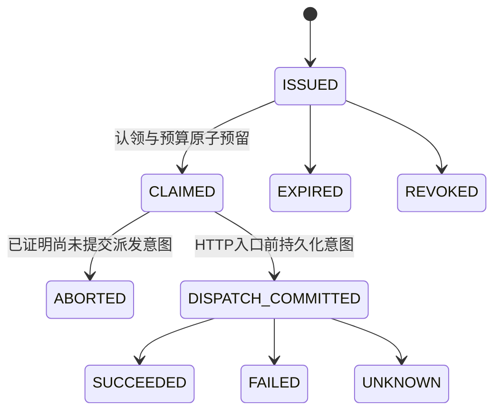

# P5-LIVE 单次执行授权设计

日期：2026-10-15，Asia/Shanghai。范围：P5-LIVE-SAFETY 本地开发、迁移准备和离线验证。**本轮真实供应商请求为 0；以前的一次收费授权已失效，不能延用。** 不进入 P6。

## 授权边界

全局 `REAL_CALLS_ENABLED` 只是一项必要条件。普通 `/chat`、`/tasks`、旧 `/model-slots/{role}/test`、`TaskService.create` 和 `RealRuntime` 真实执行路径均拒绝 `MODEL_PERMIT_REQUIRED`。Mock、P3 Sandbox 和 P4 Gateway 保留原有独立权限规则。本阶段固定测试路径不运行 LangGraph、MCP、Skills 或 Sandbox。

`POST /api/v1/model-permits` 只接受空对象，必须通过独立的 `AGENTFORGE_MODEL_PERMIT_ISSUER_TOKEN` 认证。该凭据与 admin、审批、Runner、MCP 凭据必须不同，不发给前端或 Worker。普通管理员不能签发；模型和客户端不能指定任务、Worker、限制或状态。查询使用既有管理员认证，撤销使用独立签发身份。

签发仅在 0008 已部署、独立策略启用、全局真实开关开启、专用 Worker 在线、其它待处理任务为 0、其余三槽位停用、当日没有既有真实用量或未结预留时成功。本轮维护运行的开关、预算和出口始终保持关闭。

## 数据与绑定

0008 仅新增 `execution_permits`、`trusted_model_workers`、`permit_audit`，不改已有业务表或列。

Permit 绑定服务端生成的 `permit_id`、唯一 `task_id`、唯一 `execution_id`、Coder / openai_compatible / deepseek-flash、槽位版本、api.deepseek.com、`env:AGENTFORGE_MODEL_CODER_KEY`、序列化请求 SHA256、Worker 身份、策略摘要、有效期及状态。数据库 CHECK 固定 max_attempts=1、输出64、输入上界8192、预算USD0.005；每租户最多一个活动 Permit。UPDATE 触发器拒绝修改绑定、倒退状态、重置计数或抹除历史预留。

模型操作使用现有复合主键 `(task_id, operation_id)`，其中 `operation_id = 'permit:' + execution_id`。由唯一 Permit.task_id 和 execution_id 确定关联；Permit、ModelOperation、任务预留、日用量及审计在同一事务写入。无需向原有 ModelOperation 添加列，0007 的原有 Mock/P3/P4 功能可继续运行。0007 仅在 Permit 关闭且 Worker mode=deny 时允许就绪；Permit 查询/执行仍要求 0008，不把该兼容模式当作 Permit 已部署。

Worker 由可信本地进程启动入口登记，生成随机256位内存 proof，数据库仅保存 SHA256。证明对象有进程内 seal，不能以客户端传入的 worker_id 替代。20秒租约通过心跳续期；Permit 固定绑定某一次进程启动的身份，重启生成新身份，不继承旧授权。此设计依赖可信服务器代码、进程边界和受保护数据库角色；不宣称抵抗有权改写进程内存或数据库 owner 权限的宿主管理员。

## 状态和事务

签发使用项目 advisory lock，并检查所有非终态任务。Worker 先以既有 task lease/fence 认领任务；Permit 认领事务再按 Permit→Task→日用量顺序加锁，核验内存证明、Worker 绑定、期限、配置和请求快照。并发认领仅一个事务成功，计数与费用只增加一次。

适配器 `complete` 首先校验 sealed DispatchLease。公网 DNS 固定及请求构造之后，进入真正 HTTP Transport 之前，以短事务重新检查 Permit、Worker、task fence、slot_version、指纹和策略，提交 `DISPATCH_COMMITTED`、dispatch_attempts=1、ModelOperation pending 与审计。事务提交后才进入 `client.stream`。不持有行锁等待 HTTP/SSE 响应。HTTP 客户端 retries=0、禁用代理及重定向；不使用供应商 SDK 重试，不故障切换。

`DISPATCH_COMMITTED` 表示**可能已发送**，不是供应商收到请求的证明。进程在提交前死掉：CLAIMED→ABORTED，释放已证明未派发的额度，但 claim 和当日测试次数仍消费。提交后死掉、连接断开、超时、流不完整：UNKNOWN；HTTP明确错误可标记FAILED，但用量未知仍保留预留。恢复不会重发、重置 Permit 或生成替代授权。Redis 重复/恢复消息不能绕过 PostgreSQL 状态与唯一主键。

## 预算和审计

专用策略强制：测试/日预算各USD0.005，单次调用1，Token上界8256，输出64，重试0，任务最长60秒，模型最长30秒，完整凭据引用和精确域名/受众，thinking disabled。请求体固定为“请只回答 connected”，不含 tools 或 disabled 模式冲突的 reasoning_effort。

按已登记的保守峰值价格：8192×0.30/1,000,000 + 64×1.20/1,000,000 = **USD0.00253440**。每次签发/认领重新验证价格及上界，不相信历史计算结果；价格与策略摘要变化使授权失效。费用为保守应用估算，不是供应商账单绝对保证。已报告的缓存/推理数仅作为可选用量元数据，不擅自套用折扣。

已报告完整用量时结算估算；未报告用量、未知远端结果保留日账本和任务预留。Permit 上的历史预留不可减少。ABORTED 只释放活跃额度，不抹除记录或返还调用次数。

审计记录 permit/execution、单调序号、前后状态、时间、前一事件哈希和当前内容哈希。事件与状态/预算在同一事务提交。DTO不含 proof、Key、Authorization 或思考正文。SSE仅广播字符数进度和完成后的脱敏回答。HTTP错误只保存规范化错误码和状态，不存原始敏感响应。

## 迁移与运行

初次离线修复阶段主库保持0007。随后获单独部署授权，于2026-10-15 22:45 +08:00在备份、完整恢复及升降级演练后应用主库0008；20张原业务表指纹不变，新增三表为空。见[P5_LIVE_SAFETY_DEPLOYMENT_REPORT](P5_LIVE_SAFETY_DEPLOYMENT_REPORT.md)。空历史库可演练降级；若有任何Permit/审计记录，降级拒绝，必须另行审查保留证据的备份恢复/前向修复，不可删未知费用记录。

部署完成不意味着收费获准。真实调用前仍需确认凭据由用户PowerShell安全继承、服务配置一致、独立签发身份及全新的一次收费授权。本轮不创建可用于真实模型的Permit，不设置真实签发凭据。

`scripts/test-real-models.py --permit-id <服务端ID>` 仅观察已签发授权，最多等待60秒；不读取模型Key、不签发、不创建Chat、不派发、不重试。无ID时只输出BLOCKED。API签发才是唯一受控入口，不能用旧的 `--roles all` 测试。

## 核心源码

- `backend/app/domain/permits.py`、`backend/migrations/versions/0008_execution_permits.py`：结构、唯一约束和单调状态保护。
- `backend/app/services/permit_authority.py`：独立签发认证、进程内证明及派发能力。
- `backend/app/services/execution_permits.py`：固定授权、原子预留、派发意图、结算和恢复。
- `backend/app/api/v1/permits.py`、`services/tasks.py`、`services/orchestration/real_runtime.py`、`workers/engine.py`、`providers/openai_compatible.py`：所有真实入口的门禁。
- `tests/integration/test_execution_permits.py`、`tests/fixtures/permit_process_worker.py`：真实数据库竞争和实际OS崩溃重启。
- `tests/http/test_permit_api.py`、`tests/unit/test_permit_boundaries.py`：公开入口及直接适配器绕过拒绝。
